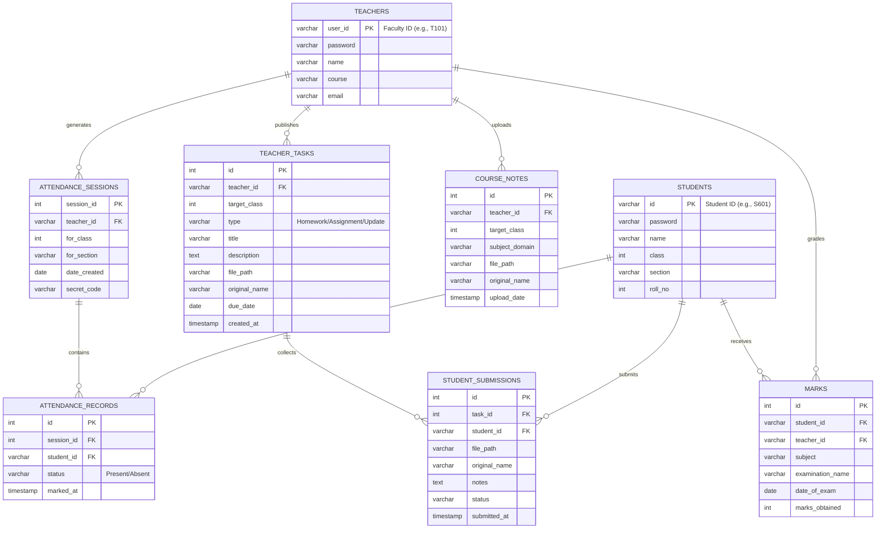

# Database Entity-Relationship (ER) Diagram

This diagram visualizes the structure and relationships of all tables in your SQLite database.

## Relationship Legend:

- `||--o{` : **One-to-Many**. (E.g., One Teacher can publish Many Teacher Tasks).
- **PK**: Primary Key (Unique identifier for the row).
- **FK**: Foreign Key (Reference to a Primary Key in another table).

## Core Systems Breakdown:

1. **Identity & Authentication**: The `STUDENTS` and `TEACHERS` tables form the backbone. Every other table ties back to these users.
2. **Attendance Protocol**: A multi-step process where `TEACHERS` open an `ATTENDANCE_SESSION`, and `STUDENTS` log specific `ATTENDANCE_RECORDS` validating against that specific session ID and code.
3. **LMS & Assignments Tracking**: `TEACHER_TASKS` act as the master broadcast node targeting specific classes. `STUDENT_SUBMISSIONS` acts as the securely mapped receiver, requiring both a valid `task_id` and `student_id` to exist securely. If the core Task is deleted via `fs.unlink`, the database cascades the wipe downward.
4. **Academics Core**: Both the `COURSE_NOTES` and `MARKS` tables establish simple one-way streams linking the Teacher's inputs directly to the filtered Student data queries (isolated by `target_class` or specific `student_id`).
